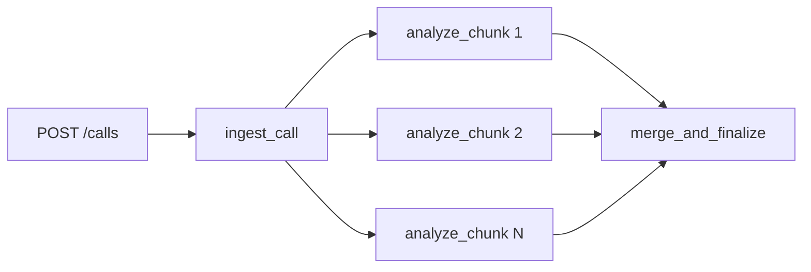

# Learning Celery by breaking it

A hands-on lab for understanding how Celery behaves when things go wrong. A realistic call-processing
pipeline runs on your machine; you break it on purpose (kill workers, inject failures); a **visualizer**
shows, in Celery's own terms, what happens to every task.

Free and local: Docker Compose only, no cloud accounts, no paid APIs.



*A chord: the chunks run in parallel and the merge runs once **all** of them have succeeded.*

## Run it

Needs Docker (Docker Desktop or OrbStack) and `make`. Nothing else to install.

```bash
make up         # build and start everything (the first run downloads images)
make trigger    # run one call end to end, in the terminal
```

Then open **http://localhost:8200**, pick a workflow in the left panel, press *Launch*, and watch the ball move.

## Where to go next

| I want to... | Read |
|---|---|
| Learn step by step, breaking things on purpose | [Tutorial](docs/tutorial.md) |
| Understand the Celery ideas behind what I see | [Concepts](docs/concepts.md) |
| See how the pieces fit together | [Architecture](docs/architecture.md) |
| Use, extend or reuse the visualizer | [Visualizer](docs/visualizer.md) |
| Do one specific thing (another broker version, my own project, dev checks) | [How-to](docs/how-to.md) |
| Look something up (states, flags, ports, `make` targets, variables) | [Reference](docs/reference/) |
| See measured numbers | [Results](docs/results.md) |
| Compare Celery with Redis, Kafka and Temporal | [Comparison](docs/comparison.md) |

The full map, and how to keep these docs current, is in [docs/README.md](docs/README.md).

## Where to look while it runs (localhost only)

| URL | What |
|---|---|
| http://localhost:8200 | The visualizer (start here) |
| http://localhost:8100/docs | The pipeline's own API |
| http://localhost:5555 | Flower: fleet-level dashboards and metrics |
| http://localhost:15672 | RabbitMQ UI (`pipeline` / `pipeline`) |

Every port, and the variable that overrides it, is listed in [reference/services.md](docs/reference/services.md).
