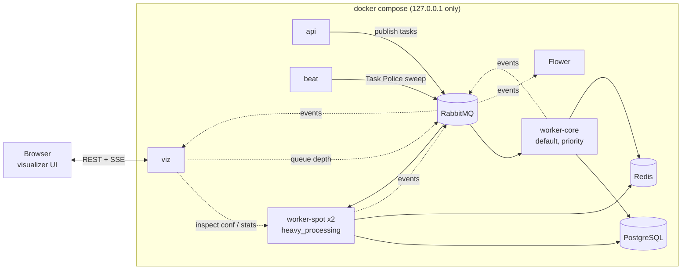
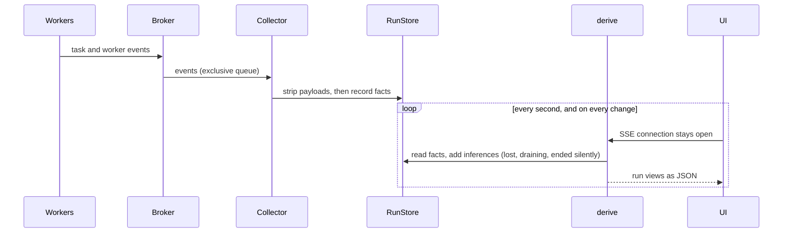

# Architecture

## The stack

Solid lines carry work; dotted lines are observation only. Every service, image, port and command is in
[reference/services.md](reference/services.md).

## Queues

| Queue | Consumed by | Why separate |
|---|---|---|
| `heavy_processing` | `worker-spot` | long chunk work, on hardware that can disappear (the "Spot fleet") |
| `default` | `worker-core` | ingest and the chord callback |
| `priority` | `worker-core` | the Task Police, never stuck behind chunks |
| `dead_letter` | nobody | parking place for rejected messages, inspected by hand |

## How the visualizer works

The split is deliberate: the **store** only records facts that arrived as events; **derive** produces the
guesses (and labels them as guesses). More in [Visualizer](visualizer.md).

## What is reused, and what is not

Before building the monitor, three existing tools were checked for overlap, with real data:

| Candidate | What it offers | Decision |
|---|---|---|
| **Celery's own `events.state.State`** (what Flower is built on) | folds events into task and worker objects | **Not enough.** It collapses `self.replace()` into one task and leaves a blocked chord's parent in `STARTED` forever, which are exactly the cases this monitor exists for. One small piece overlaps (worker liveness) |
| **Flower** and its `/metrics` | task lists, worker status, Prometheus metrics | **Complementary, kept in the stack.** Its metrics are aggregates with no task id or run, so they cannot show one workflow's journey. Use it for fleet dashboards and alerts |
| **RabbitMQ's Prometheus plugin** | per-queue `ready` and `unacked` | **Reused.** Events cannot say when a message is acknowledged; the broker can, so the queue panel reads it instead of counting |

Rule of thumb: Flower and Prometheus answer *"is the fleet healthy?"*; this monitor answers *"what happened
to this workflow, and why?"*.

## Decisions worth knowing

- **Python backend, static front end.** The data source is Celery's event stream, which is Python. The UI is built
  by Node at image-build time and served as plain files, so no Node runs in production.
- **Read-only by default.** There is no endpoint that sends, revokes or purges anything. The demo stack enables a
  launcher (switch it off with `VIZ_CATALOG=`) that can only start *named* scenarios with validated parameters.
- **Payloads are dropped before storage.** Task arguments, results and tracebacks never enter the store unless you opt in.
- **Exclusive event and control queues.** Required by RabbitMQ 4.3+; see [RabbitMQ 4 and Celery](rabbitmq4-deprecations.md).
