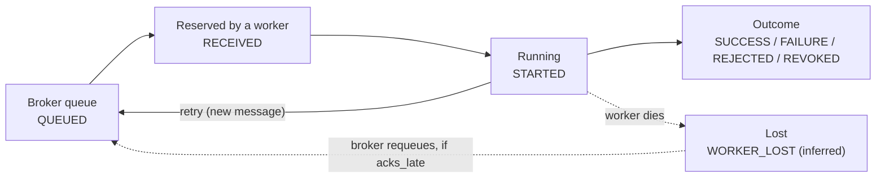

# Concepts

The Celery ideas behind what the visualizer shows, and the places where common explanations turn out to
be wrong. Each point was checked against this project's behaviour.

## Vocabulary

| Term | Meaning here |
|---|---|
| **Task** | A Python function run by a worker |
| **Broker** | RabbitMQ: holds messages until a worker takes them |
| **Worker** | A process that consumes messages and runs tasks in a pool of child processes |
| **Ack** | The worker telling the broker "you can forget this message". *When* it does so decides what survives a crash |
| **Result backend** | Redis: stores return values and the chord's bookkeeping |
| **Prefetch** | How many messages a worker reserves in advance |
| **Canvas** | `chain` (A then B), `group` (A, B, C together), `chord` (a group, then one callback) |
| **`self.replace`** | A task swaps itself for a workflow computed at run time |
| **`Reject(requeue=False)`** | Refuse a message without putting it back; with a dead-letter exchange the broker parks it |
| **Soft / hard time limit** | Soft raises an exception inside the task so it can clean up; hard kills the process |
| **beat** | Celery's scheduler (here: the Task Police sweep) |

## The three settings that decide whether work survives

Explained line by line in `config.py`; in short:

```python
task_acks_late = True              # acknowledge AFTER the task finishes, not when it starts
task_reject_on_worker_lost = True  # if the pool child dies, requeue instead of dropping
worker_prefetch_multiplier = 1     # do not hoard messages behind a long task
```

Celery's own defaults are the opposite of all three, which is why they lose work on Spot instances. The
[experiments](tutorial.md#7-a-worker-dies) show each default failing.

## The task lifecycle



The four columns of the visualizer are exactly these stages. Every state, with its Celery name and what
causes it, is in [reference/states.md](reference/states.md).

## What Celery's events do and do not tell you

The visualizer is built only from Celery's event stream, and the stream has gaps. Each of these was
measured and has a test.

- **A task id is not unique.** `self.replace()` reuses it under a new name, and the original emits **no**
  terminal event. A naive monitor shows it "running" forever.
- **A SIGKILLed worker emits nothing**, not even `worker-offline`. "Lost" can only be inferred from missing heartbeats.
- **`worker-offline` is not "dead".** It is sent at the *start* of a warm shutdown, while running tasks continue.
- **Workers interleave full and short heartbeats.** Only full ones carry `active` (the number of running tasks).
- **Heartbeat timing varies.** The docs say every minute; these workers send every 2 seconds.
- **No event carries `redelivered`.** A redelivery is a repeated `task-received` with the same `retries`.
- **A chord's join is not in the data.** The callback has one parent (the last task to finish); the other
  edges are inferred.
- **The ack is not observable.** Events cannot say when a message is acknowledged. Only the broker knows
  (its *unacked* count), and `acks_late` can be explained but not measured from events.
- **Events are lossy.** A consumer that re-subscribes drops what is published in the gap.

## Precision notes: where common explanations are wrong

1. **`reject_on_worker_lost` is not what saves you from a container kill.** A killed container drops its
   connection and RabbitMQ requeues unacked messages by itself; that needs only `acks_late`.
   `reject_on_worker_lost` covers a *pool child* dying while its parent survives (the OOM killer).
2. **Prefetched messages are not lost when a worker dies on RabbitMQ.** They are unacked, so they are
   requeued. The real cost of prefetch is *unfair dispatch*.
3. **SIGTERM is not a Spot eviction.** Celery turns it into a warm shutdown and finishes the running task.
   A real eviction is SIGTERM followed by power-off, or just power-off.
4. **`chain(ingest | chord(group(chunk_ids)))` cannot be built up front** when ingest creates the chunks.
   Use `self.replace(...)`.
5. **`Reject` never reaches the chord.** A rejected task stores no result, so the chord just waits. Record
   failure in the database too: treat the database as truth and the chord as a trigger.
6. **Dead-lettering into a missing exchange silently drops the message.** Declare the topology yourself
   (the `bootstrap` service does).
7. **Lease length is your failover latency.** After a kill the replacement waits for the dead worker's lease
   to expire. Shorter means faster recovery and more risk of duplicate work.
8. **`self.replace(group(...))` quietly becomes a chord.** Celery adds a built-in `celery.accumulate` join so
   the replaced task has one result. To get a plain group, publish it from inside the task without `replace`.
9. **A group submitted from a client has no shared identity.** Every task gets its own root id, so a monitor
   cannot tell they belong together. Fan out from a parent task instead. (Celery 4.4.7 behaves the same for chords.)
10. **A task killed *and* recovered within a few seconds is never "lost".** The broker can requeue it faster
    than a monitor can be sure the worker is gone; you only see a *redelivered* chip.

## Prefetch

A worker with `worker_prefetch_multiplier = N` and concurrency `C` reserves up to `N × C` messages at once.
Reserved messages are unacknowledged, so the broker's *unacked* count rises even for tasks that have not started.
With a high multiplier and tasks of very different lengths, one worker can sit on a queue of work behind a slow
task while another is idle. [`make test-prefetch`](tutorial.md#9-fair-dispatch) demonstrates it.

## Where next

[Pipeline](pipeline.md) shows these ideas applied; [Visualizer](visualizer.md) shows how they are read off the screen.
