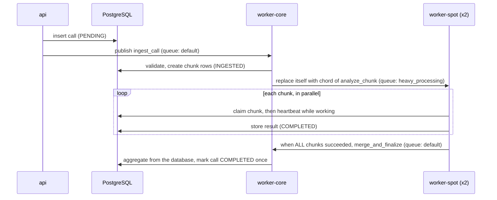
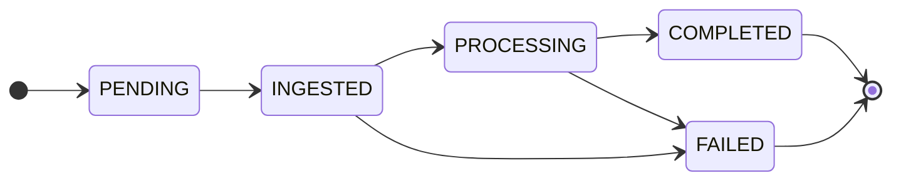

# The call pipeline

The workload used for every experiment: a simulated call-intelligence job. Audio is split into chunks,
each chunk is analysed in parallel (5 to 10 seconds of pretend transcription and speaker analysis), and a
final step merges the results. Everything is simulated, so it costs nothing.

## How a call flows

1. **`POST /calls`** inserts a `calls` row and publishes `tasks.ingest_call`.
2. **`ingest_call`** validates the call, creates the chunk rows, and *replaces itself* with the chord
   (`self.replace(chord(group(analyze_chunk...), merge_and_finalize))`). The textbook
   `chain(ingest | chord(group(...)))` cannot be written up front, because the chunk ids do not exist until
   ingest creates them.
3. **`analyze_chunk`** first **claims** its chunk in PostgreSQL, then heartbeats while it works. The claim
   makes it idempotent (below).
4. **`merge_and_finalize`**, the chord callback, aggregates from the *database* and marks the call
   `COMPLETED` exactly once. A second delivery is a logged no-op.
5. No worker ever blocks waiting for another task: no `.get()`, no `allow_join_result`.

## State machines

A chunk has the same shape minus `INGESTED`: `PENDING → PROCESSING → COMPLETED | FAILED`. A chunk can also
return from `PROCESSING` to `PENDING` when it is released for a retry.

## Why it is built this way

Celery guarantees at-least-once delivery and nothing stronger, so a task can run twice, concurrently, or after
its worker was presumed dead. Every design choice follows from that.

- **Claim, lease, fence.** A task first claims its row in PostgreSQL. A finished chunk returns its stored
  result; a chunk with a live owner makes the duplicate wait; a chunk whose owner stopped heartbeating (the
  lease expired) is taken over. Every later write is *fenced* by the claim token, so a zombie worker that
  wakes up cannot overwrite newer work.
- **The database is the truth, the chord is a trigger.** The merge reads chunk results from PostgreSQL and
  does not trust the list Celery passes it, so it gives the same answer however many times it runs.
- **The retry budget lives in the database.** Celery's own retry counter cannot see crashes or redeliveries;
  the `attempts` column can, which is what stops a poison pill from looping forever.
- **The Task Police** (`tasks.police_sweep`, run by beat) re-dispatches a call that has shown no sign of life
  for a threshold. It is the band-aid many teams grow because a broker message is not a durable record that
  work must finish. Under the hardened settings it has nothing to do; under stock settings it is the only
  thing that rescues a lost chunk. `make police-now` runs one sweep on demand. See [Comparison](comparison.md)
  for how Temporal removes the need.

## Failures on purpose

Pass a fault per chunk when starting a call: `POST /calls {"num_chunks": 6, "faults": {"1": "transient"}}`,
or pick one from the visualizer's launcher. Each fault exists to exercise exactly one Celery feature.

| Fault | What it does | Celery feature it shows | Ends as |
|---|---|---|---|
| `transient` | fails on attempts 1 and 2, then works | retry with exponential backoff | chunk succeeds on attempt 3 |
| `permanent` | always raises `PermanentError` | `Reject(requeue=False)` and the dead-letter queue | chunk rejected, call FAILED |
| `crash` | SIGKILLs its own pool process every time | `task_reject_on_worker_lost` and the attempts cap (poison pill) | chunk rejected after 4 attempts, call FAILED |
| `hang` | sleeps forever on attempt 1 | soft time limit | chunk retried, then succeeds |
| `bug` | raises an unexpected exception | task `FAILURE`, then the chord's error callback | call FAILED |
| `slow` | takes about 22 seconds | fair dispatch (prefetch) | chunk succeeds, slowly |

Terminal shortcuts: `make trigger-retry`, `make trigger-bad`, `make trigger-poison`, `make trigger-bug`.
`make dlq` shows parked messages and `make events ID=<call_id>` shows the audit trail behind any call.

## Known limitations (deliberate)

- If a call fails, its other in-flight chunks keep running to completion (wasted work, harmless).
- The API publishes after committing the database row (no transactional outbox); a failed publish leaves a
  `PENDING` call that the Task Police recover.
- Classic RabbitMQ queues on a single node by default. Quorum queues are one variable away
  (see [How-to](how-to.md#run-on-quorum-queues)) and are the natural next step.
- The schema is created with `create_all`, not migrations.
